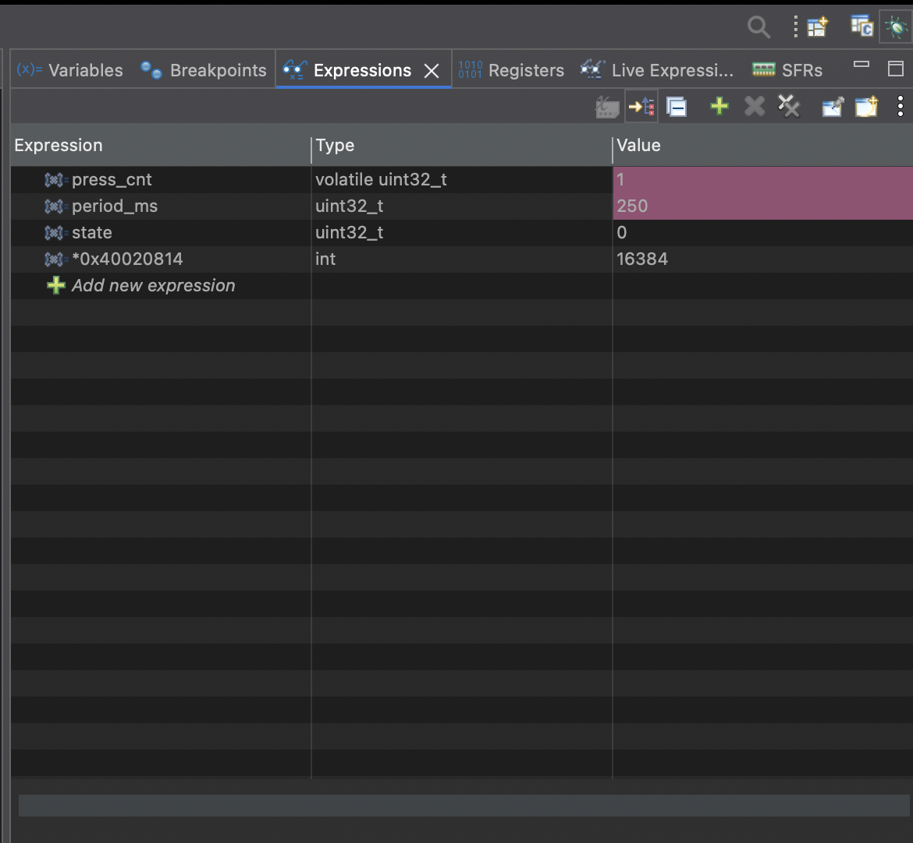

# Модуль 4.7 · SWD debug на STM32

Домашнє завдання Beetroot Academy на STM32F411CEU6 (Black Pill). Світлодіод на `PC14` блимає, а натискання кнопки на `PA0` змінює інтервал між перемиканнями по колу — 100, 250, 500, 1000 і 2000 мс.

Головний цикл зчитує кнопку з `GPIOA->IDR`, перемикає світлодіод через `GPIOC->ODR` і бере час із мілісекундного лічильника, який оновлює переривання SysTick.

## Запуск

1. Відкрий `27_11_2026.ioc` у STM32CubeMX і згенеруй проєкт для STM32CubeIDE. Скопіюй файли з `Core/` у відповідні папки згенерованого проєкту.
2. Підключи світлодіод через резистор до `PC14`. Підключи кнопку між `PA0` і `GND`. Внутрішню підтяжку кнопки ввімкнено в конфігурації.
3. Збери проєкт і проший плату через ST-LINK. Натисни кнопку, щоб змінити інтервал блимання.

## Демонстрація

Після першого натискання `press_cnt` дорівнює 1, а `period_ms` — 250 мс. Значення 16384 (`0x4000`) у регістрі `GPIOC->ODR` показує, що в момент знімка `PC14` був у високому стані.

