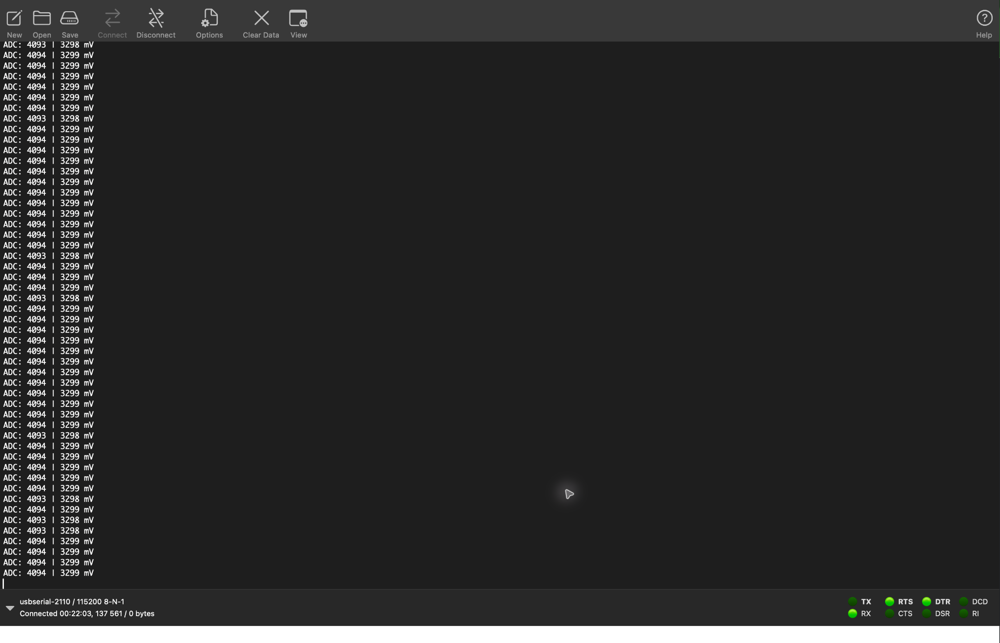

# Модуль 4.6 · DMA на STM32

Домашнє завдання Beetroot Academy на STM32F411CEU6. ADC1 вимірює напругу на `PA0`, а прошивка передає середнє з 16 вибірок у CoolTerm кожні 200 мс.

| Операція | Налаштування |
| --- | --- |
| ADC1, канал 0 | `PA0`, 12 біт, `DMA2 Stream 0 / Channel 0`, кільцевий режим |
| USART2 TX | `PA2`, `DMA1 Stream 6 / Channel 4`, нормальний режим |
| CoolTerm | 115200 бод, 8N1, без керування потоком |

## Запуск

1. Відкрий `25_11_2026.ioc` у STM32CubeMX, вибери STM32CubeIDE як toolchain і згенеруй проєкт. Скопіюй файли з `Core/` у відповідні папки згенерованого проєкту, збери його та проший через ST-Link.
2. Підключи `PA2` до `RX` USB–UART і з’єднай `GND` плати та адаптера. Для перевірки ADC подай на `PA0` напругу в межах 0–3,3 В.
3. Відкрий порт у CoolTerm і натисни RESET. Після `STM32 25_11_2026: USART2 ready` з’являться рядки з кодом ADC і напругою в мілівольтах.

```text
ADC: 4093 | 3298 mV
ADC: 4094 | 3299 mV
```

## Демонстрація

Виведення результатів вимірювання ADC через USART2 з DMA у CoolTerm:


