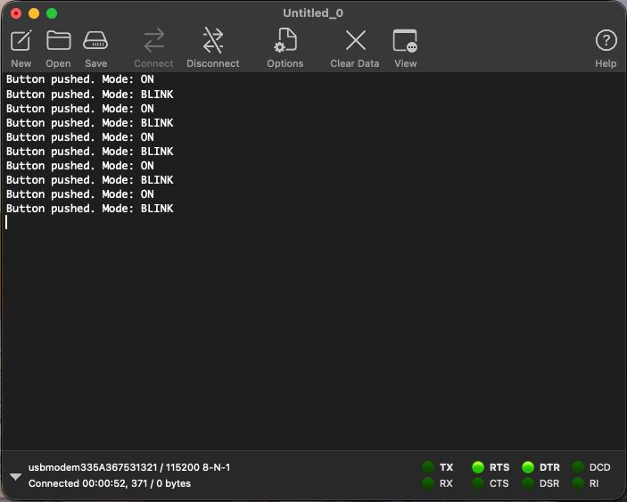

# Embedded Development — Module 2, Lesson 2.9

STM32F411 · STM32CubeMX + STM32CubeIDE

LED on PC13 blinks every 500 ms. The button on PA0 uses an EXTI interrupt with 50 ms debounce and switches between blinking and always-on modes. USB CDC sends serial log messages.

`setup()` and `loop()` are implemented in `Core/Src/app.c` and declared in `Core/Inc/app.h`.

## Result

